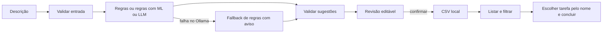

# Meu Assistente de Rotina

[← Projeto integrador](../README.md) · [Aula 1](construcao.md) · [Aula 2](personalizacao.md)

Transforme descrições do cotidiano em uma lista de tarefas revisada por você.
O aplicativo roda no navegador do próprio computador, usa CSV e funciona sem
Ollama pelo modo de regras. O classificador Scikit-learn é pequeno e treinado
com exemplos fictícios; o LLM local sugerido é Qwen3 1.7B, com Qwen3 0.6B como
alternativa leve. Não exige conta, API paga, nuvem, ajuste de pesos ou GPU.

Esta é uma prática adicional para **exatamente duas aulas de duas horas**,
com Python básico: variáveis, condicionais, listas, dicionários e funções.
A turma recebe o aplicativo pronto e modifica pequenas partes. Construir tudo do
zero e instalar modelos durante a aula não cabe nesse tempo. A preparação abaixo
é feita antes dos encontros; as duas aulas já incluem pausas de dez minutos.
A trilha matemática e o projeto de sensores continuam disponíveis e preservados.

## Preparar antes das aulas

Na raiz do repositório, use Python 3.11 ou 3.12. Veja o [guia de ambiente](../../docs/ambiente-local.md).
Se já existe uma `.venv` válida neste caminho, apenas ative-a e instale o extra.
A instalação requer internet; depois de baixar bibliotecas/modelo, a atividade é local.

Linux/macOS:

```bash
python3 -m venv .venv
source .venv/bin/activate
python -m pip install -e ".[dev,rotina]"
python -m sos_ml.rotina.app
```

Windows PowerShell, depois de confirmar que `python --version` mostra 3.11 ou 3.12:

```powershell
python --version
python -m venv .venv
.\.venv\Scripts\python.exe -m pip install -e ".[dev,rotina]"
.\.venv\Scripts\python.exe -m sos_ml.rotina.app
```

Esse caminho não exige ativação. Nos demais exemplos deste guia, substitua
`python` por `.\.venv\Scripts\python.exe` ou ative o ambiente com
`.\.venv\Scripts\Activate.ps1`. Se `python` não funcionar, consulte o
[diagnóstico Windows](../../docs/ambiente-local.md#windows-powershell).
`python3.exe -m venv .venv` é uma alternativa **quando esse comando existe e sua
versão foi conferida**. O launcher `py` não é pré-requisito desta prática.

Abra **http://127.0.0.1:7860**. Mantenha o terminal aberto; Ctrl+C encerra o
servidor. O navegador é só a interface: as funções Python executam no processo
local. O aplicativo não abre link público. Gradio é instalado só neste extra;
Ollama é um programa separado, não um pacote obrigatório do projeto.

Para experimentar o LLM, instale o [Ollama oficial](https://ollama.com/download)
e execute no terminal antes da aula:

```bash
ollama pull qwen3:1.7b
ollama list
```

Inicie o Ollama pelo aplicativo de desktop ou, se ele não estiver em execução,
por `ollama serve` em outro terminal. Não inicie dois servidores na mesma porta.
Abra **Como o assistente funciona** na lateral e escolha **LLM local (Ollama)**; o modelo padrão é `qwen3:1.7b`.
O código chama somente `127.0.0.1:11434`, sem proxies, e não baixa modelos sozinho.

## Primeira experiência verificável

1. Na aba **Conversa**, escreva `Pagar boleto hoje; estudar Python`. O modo inicial é regras.
2. Clique **Enviar ↑**. O assistente responde e abre **Revise antes de guardar**.
3. Na tabela de revisão, dê dois cliques na prioridade de estudar e escreva `baixa`.
4. Clique **Confirmar e salvar tarefas**. A conversa confirma o salvamento.
5. Abra **Minhas tarefas**, filtre a categoria estudos e escolha a tarefa pelo nome
   em **Qual tarefa você terminou?**. Clique **✓ Marcar como concluída**.
6. Reinicie o aplicativo e abra **Minhas tarefas**. A conclusão permanece.

A revisão tem três colunas editáveis: descrição, categoria e prioridade. Escreva
as categorias e prioridades exatamente como nas listas exibidas; remova linhas
indesejadas pelo menu de uma célula. Lista vazia não pode ser salva. Um novo envio
substitui a revisão anterior. **Nova conversa** limpa o histórico e as sugestões
não salvas; suas tarefas confirmadas continuam no CSV.

A tela tem sugestões rápidas para preencher a entrada, respostas em conversa,
cartões de tarefas e contadores gerais de pendentes, concluídas e prioridade alta.
Filtros mudam os cartões e a seleção de conclusão, sem mudar esses totais gerais.
A tabela bruta fica em **Ver os dados como tabela**. A interface guarda os IDs
internamente: você escolhe pelo nome, sem precisar digitar números.

Abra **Como o assistente funciona** para trocar entre regras, ML e LLM; o seletor
Qwen3 aparece quando o modo LLM está escolhido. Em **Por dentro da IA · compare os
métodos**, veja a comparação da análise original. Ela não é recalculada enquanto
você edita células. A conversa é uma apresentação dos envios: **cada mensagem é
interpretada individualmente**, sem memória de contexto pelo modelo. O histórico
fica só na sessão e é perdido ao recarregar; as tarefas salvas permanecem.

O CSV aparece em `data/rotina/tarefas.csv`, ignorado pelo Git. Há cinco colunas:
`id,descricao,categoria,prioridade,status`. IDs não mudam com filtros. Descrições
iguais, ignorando maiúsculas/minúsculas, não são duplicadas enquanto pendentes.
Para mudar prioridade de uma tarefa já salva, esta versão não oferece edição:
conclua-a e cadastre a nova tarefa. Repetir conclusão não cria registros extras.

## Regras, ML e LLM: quem faz o quê?

| Componente | Como funciona | O que aprende | Limitação a observar |
|---|---|---|---|
| Regras em Python | separa por `;` ou linha nova, procura palavras, define prioridade | nada | não entende negação ou sinônimos gerais |
| Regras + ML | mesmas separação/prioridade; Naive Bayes sugere categoria | vocabulário e relações palavra/categoria nos exemplos | perde ordem e contexto; pode classificar errado |
| LLM local | Qwen3 gera descrições, categorias e prioridades em JSON | usa pesos previamente treinados; não treinamos Qwen3 aqui | pode omitir, inventar ou interpretar errado |
| Validação Python | verifica campos, tipos, tamanhos e opções permitidas | nada | uma tarefa inventada ainda pode ter estrutura válida |
| Revisão humana | confirma, corrige e remove sugestões | a pessoa decide | precisa conferir intenção e privacidade |
| CSV | persiste somente após confirmação | nada | não é banco multiusuário nem cópia de segurança |



O LLM é um modelo de ML profundo, não uma categoria separada de ML.
Aqui comparamos **regras escritas**, **classificação supervisionada pequena** e
**geração com modelo pré-treinado**. O sistema completo inclui os três caminhos,
contrato, interface, armazenamento e decisão da pessoa.

## Ler o código na ordem

Todos os caminhos a seguir são relativos à raiz do repositório.

| Arquivo | Pergunta para orientar a leitura |
|---|---|
| [`domain.py`](../../src/sos_ml/rotina/domain.py) | quais dados uma tarefa pode conter? |
| [`rules.py`](../../src/sos_ml/rotina/rules.py) | como produzir uma sugestão só com listas, if e funções? |
| [`exemplos.csv`](../../src/sos_ml/rotina/exemplos.csv) | quais textos e rótulos foram inventados para treino/teste? |
| [`classifier.py`](../../src/sos_ml/rotina/classifier.py) | como palavras viram números e categorias? |
| [`llm.py`](../../src/sos_ml/rotina/llm.py) | como pedir JSON e verificar a resposta local? |
| [`service.py`](../../src/sos_ml/rotina/service.py) | como escolher método e avisar sobre fallback? |
| [`storage.py`](../../src/sos_ml/rotina/storage.py) | como guardar estado e manter IDs? |
| [`app.py`](../../src/sos_ml/rotina/app.py) | como conversa, revisão e tarefas chamam essas funções? |
| [`interface.css`](../../src/sos_ml/rotina/interface.css) | como ajustar visual e layout sem mudar as regras? |

Comece pelas regras antes de estudar a biblioteca. Em `CountVectorizer`, cada
coluna corresponde a uma palavra; cada linha, a um texto. A célula conta
ocorrências. Para um vocabulário `[boleto, estudar]`, `estudar estudar` vira `[0,2]`.
O Naive Bayes usa frequências por classe com suavização para sugerir uma categoria.
Leia a explicação da fórmula no código antes de chamar `fit()`.

O CSV de exemplos tem **42 textos de treino e 14 de teste**, seis e dois por
categoria. A partição está explícita e o vocabulário é ajustado só no treino.
As categorias têm igual frequência: um baseline constante acerta 2/14 nesse teste.
Execute para ver cada previsão e erro, sem consultar Ollama:

```bash
python -m sos_ml.rotina.classifier
python -m pytest tests/test_rotina.py tests/test_rotina_ui.py
```

O teste fixo pequeno verifica o percurso didático; sua acurácia não demonstra
qualidade para linguagem geral. Para experimentar escolhas, use novos exemplos
de desenvolvimento. Depois reserve um novo teste final, sem usá-lo para ajustes.
As tarefas pessoais salvas não treinam o modelo. Ao editar o CSV de exemplos,
reinicie o app para limpar o cache do classificador.

## Computadores com poucos recursos

O percurso obrigatório de duas aulas usa **Regras em Python** e **Regras + ML**.
O instrutor pode demonstrar o LLM em uma máquina preparada; o estudante explica o
contrato e o fallback sem precisar baixar pesos. Todos recebem a mesma rubrica.
Feche programas pesados e trabalhe com duas ou três tarefas por vez.

Para testar a alternativa leve:

```bash
ollama pull qwen3:0.6b
```

Selecione `qwen3:0.6b` no aplicativo. A biblioteca oficial lista aproximadamente
1,4 GB para o download do 1.7B e 523 MB para o 0.6B; isso **não é a RAM total**.
Runtime e contexto consomem memória adicional. Não há promessa de velocidade ou
mínimo universal de RAM. Teste na máquina da turma antes da aula. O pedido limita
a saída a 1024 tokens e desativa pensamento separado, mas modelos pequenos podem
ainda errar. Se demorar, use regras; o timeout de rede é de 60 s por operação de I/O.
Não é preciso desinstalar Ollama para usar o fallback.

Sem interface instalada, o núcleo continua utilizável no terminal:

```bash
python -c "from sos_ml.rotina.rules import extract_by_rules; print(extract_by_rules('Estudar Python'))"
```

## Cuidados e limites concretos

Use dados fictícios em apresentações e capturas. Evite senhas, documentos,
extratos, dados de clientes ou beneficiários. Local não significa criptografado:
o CSV é texto simples e outras pessoas com acesso ao computador podem lê-lo.
Para uma demonstração limpa, use `python -m sos_ml.rotina.app --csv data/rotina/demo.csv`.
Faça cópia privada do CSV com o aplicativo encerrado. Não o publique no Git.

Uma entrada tem até 2000 caracteres; cada tarefa, até 200; cada análise, até dez.
Excesso é recusado, não truncado. Fórmulas de planilha e controles são recusados.
Uma resposta LLM fora do contrato é descartada integralmente e as regras tentam
processar a entrada original. Nem as regras nem o LLM executam pagamentos,
candidaturas, compras ou mensagens: a saída é uma lista que você revisa.
Datas, lembretes automáticos, valores financeiros, exclusão e login estão fora
desta versão. Finanças aqui significa organizar ações, não recomendar investimentos.

Use um processo por CSV e uma pessoa por aplicativo; abas compartilham o mesmo
arquivo. O lock protege cliques no processo, sem sincronização entre servidores.
Um CSV inválido bloqueia alterações e é preservado para inspeção. Gravação atômica
reduz arquivos incompletos; não substitui backup nem proteção de acesso.

[Plano da aula 1](construcao.md) · [Plano da aula 2](personalizacao.md) ·
[Exercícios](exercicios.md) · [Solução de problemas](problemas.md) ·
[Orientações do instrutor](solucoes-instrutor/README.md) · [Referências](referencias.md)
